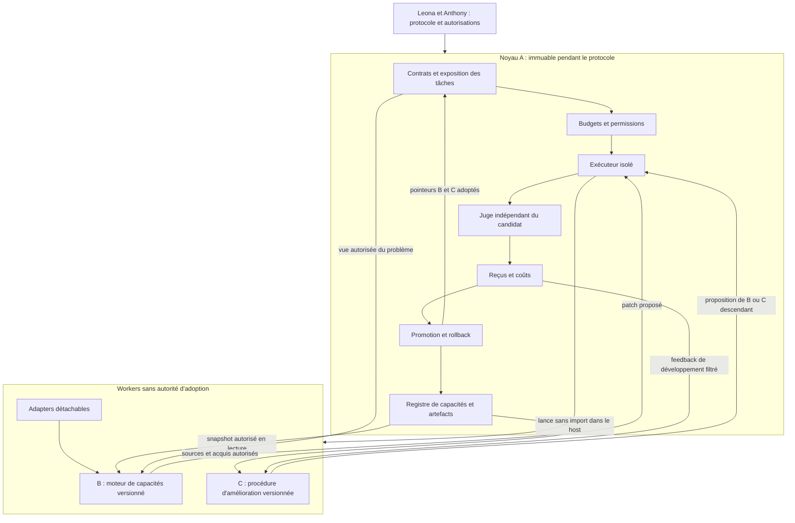

# Genesis — conception du cœur évolutif

**Statut : proposition de conception pour examen par Leona et accord d'Anthony avant toute implémentation.**

Date : 11 octobre 2026. Branche : `audit/genesis-architecture`. Référence de code : `72af3e9a3eddcdbdbce1059572d9aa257a45234b`. Assistance de rédaction et d'analyse : OpenAI Codex. Ce document prolonge [l'audit architectural](../audits/GENESIS_ARCHITECTURE_AUDIT_2026-10-11.md) ; il ne rapporte aucun nouveau résultat expérimental.

## Synthèse de la décision recommandée

1. Construire un petit contrôle de confiance immuable et deux objets versionnés : moteur de capacités et procédure d'amélioration.
2. Choisir l'évolution de composants exécutables isolés, plutôt qu'un catalogue extensible seulement par activation de règles prédéfinies.
3. Commencer en Python avec propositions symboliques locales, sans LLM à l'exécution ni téléchargement de modèle.
4. Conserver les validations, budgets, identités, journaux et rollback ; encapsuler leurs interfaces actuelles.
5. Unifier les capacités dans un registre de références et de preuves, sans convertir ni réécrire les mémoires historiques.
6. Autoriser l'évolution de la présélection et des expériences de développement, jamais du juge final ou du budget.
7. Mesurer séparément gain du solveur, gain de l'améliorateur et contribution de la mémoire, à coût total explicite.
8. Utiliser seulement des exercices déjà publics et exposés pour la première tranche, sans conclusion de généralisation.
9. Arrêter si la génération locale ne propose rien d'utile ou si le signal ne distingue pas les procédures ; ne pas changer de banc pour obtenir un succès.
10. Ne rien implémenter ni exécuter avant l'examen de Leona et l'accord d'Anthony.

## 1. Diagnostic architectural synthétique

### 1.1 Point de départ vérifié

L'audit distingue des mécanismes utiles, mais plusieurs lignées dont les apprentissages et états ne forment pas un cœur commun. Les limites pertinentes pour cette conception sont :

| Fait établi dans le code ou les archives | Conséquence pour la conception |
|---|---|
| G6 choisit parmi trois corps de matcher ; G10 encode trois transitions, puis s'arrête | Un successeur doit pouvoir contenir un programme de transformation absent du parent, sans nouveau branchement ajouté par l'hôte entre étapes. |
| Les générateurs G11 couvrent mal les correctifs frais ; V2.1 peut compiler sans proposer de nouvelle hypothèse pertinente | Le moteur doit pouvoir construire des changements structurels et des calculs, au-delà du rejeu de templates. Leur pertinence devra être mesurée. |
| Les règles G12 peuvent être non applicables, non chargées ou éliminées par le classement | L'existence, l'applicabilité, l'émission, la sélection et l'effet d'une capacité doivent être observables séparément. |
| SELF1 ne promeut aucun descendant ; SELF2 s'arrête ; évaluation interne chère et peu discriminante | Le coût du métaniveau et la sensibilité de l'instrument sont des conditions de poursuite, pas des détails d'optimisation. |
| CIRCUIT apprend des composants mais progresse peu ; le ranker CIRCUIT2 ne transfère pas le gain requis | Rendre modifiables la recherche et ses informations, pas seulement la bibliothèque ou ses poids. Aucun succès n'en découle automatiquement. |
| Les hashes de reçus ne prouvent pas l'autorité ou l'indépendance | Les permissions et montages de processus doivent réaliser la séparation décrite par les données. |

Références déterminantes : `genesis/evolution/component_evolution.py::_candidate_functions`, `evolution/recursive_chain.py::induce_successor`, `runtime/recursive_chain_executor.py::generate_candidates`, `repair_strategist.py::generate`, `g12_operator_lab.py::validate_and_learn`, `improver_lineage.py`, `circuit_engine.py::solve/improved`. CIRCUIT2 appartient à une autre branche : code à `f6c24fee`, résultat à `e72d1aa1`, commentaire corrigé à `1c2bfdfa` ; il n'est pas intégré ici.

### 1.2 Vocabulaire scientifique du document

- **Fait** : constat du dépôt déjà examiné, sans nouvelle exécution.
- **Décision proposée** : choix technique retenu ici, à approuver avant développement.
- **Hypothèse** : propriété utile attendue, dont l'effet n'est pas démontré.
- **Non démontré** : généralisation ou capacité que ce document ne peut établir.

La capacité créative peut venir d'une recherche combinatoire, d'exemplars, de données acquises, d'un humain ou d'un modèle. Le composant qui sélectionne une proposition n'en devient pas automatiquement l'inventeur. Modifier du code, avoir un langage général et trouver une amélioration sont trois propriétés différentes.

## 2. Principes, invariants et périmètre

### 2.1 Invariants du cœur

1. **Autorité hors évolution.** Les budgets, permissions, corpus autorisés, règles terminales, validation d'identité et décisions d'adoption appartiennent au noyau de confiance A. Un candidat ne peut les élargir.
2. **Évolution par artefacts.** Aucune modification en place d'un module actif. Un descendant est un manifeste immuable qui référence des programmes, données et dépendances exacts ; l'adoption change un pointeur.
3. **Mesures indépendantes du candidat.** Les réponses et explications du moteur sont des propositions ; le host mesure et recalcule les verdicts. Une mesure impossible devient `infrastructure_error` ou `unknown`, pas un succès ni un échec comportemental inventé.
4. **Pas d'autorité implicite par hash.** Le digest identifie le contenu. Seul un processus autorisé à écrire la décision peut promouvoir. L'authentification d'une autorité distante serait un besoin distinct, absent de la tranche locale.
5. **Budget global hérité.** Toute sous-évaluation, analyse, proposition, comparaison et tentative rejetée débite le budget racine ; aucun nouveau budget n'apparaît par récursion.
6. **Provenance transitive.** Une capacité dérivée d'un patch modèle conserve cette origine, même après abstraction et réécriture locale. L'assistance humaine/IA qui crée le seed est enregistrée séparément de ses actions à l'exécution.
7. **Conservation contrôlée.** Une adoption préserve les réussites protégées du parent dans le périmètre gelé. Cela ne prouve pas l'absence de régression partout.
8. **Refus et incertitude valides.** `not_applicable`, `unknown`, `no_proposal`, `no_discrimination`, `budget_exhausted` sont des résultats explicites. Aucun d'eux ne déclenche automatiquement un appel externe.
9. **Pas de mutation des preuves.** Révisions des protocoles, nouvelles règles et nouveaux instruments produisent de nouvelles identités prospectives. Les expériences gelées et leur provenance restent intactes.
10. **Arrêt borné.** Les limites de temps, mémoire, profondeur, nombres de propositions et expositions sont définies avant exécution ; un plateau n'autorise pas à les augmenter silencieusement.

### 2.2 Décisions de périmètre

Le domaine pilote reste la réparation de programmes. La première tranche cible **Python uniquement**, parce que son AST est disponible dans la bibliothèque standard et que des exercices publics déjà exposés existent. Les outils Java/Defects4J sont conservés derrière un adaptateur, mais ne sont pas nécessaires pour vérifier le premier cycle. Aucun résultat sur Python n'est présenté comme transfert vers des bugs Java réels.

Le noyau proposé n'est pas un framework d'agents, un service distribué ou un modèle entraîné. La première version aurait un ordonnanceur séquentiel, un worker isolé à la fois, un registre local et deux manifestes évolutifs. Pas de nouvelle couche de contrôleurs historiques ni de migration massive de répertoires.

### 2.3 Publication et droits

Revue de conception consignée ici après lecture de `docs/IP_PUBLICATION_POLICY.md`, `IP_ASSET_REGISTER.md`, `docs/DUAL_LICENSING_STRATEGY.md`, `AUTHORS.md`, des documents de provenance/dépendances et de `CONTRIBUTING.md` :

- Objet : architecture publique de composants versionnés, propositions locales et validation de leur évolution ; aucune implémentation nouvelle dans ce livrable.
- Autorité : mission explicite de conception publique sur cette branche ; décisions futures à Leona et Anthony. Cette mission n'autorise aucune campagne, implémentation, publication automatique ou consommation API.
- Matériaux : code public du projet, bibliothèque standard Python, exercices publics déjà exposés. Aucun nouveau modèle, dataset, code tiers, secret ou contenu réservé ; aucune revendication de nouveauté brevetable.
- Cadre de disposition : public, sous la politique `PUBLIC_AGPL_COMMERCIAL_OPTION` existante ; aucune raison de confidentialité spécifique identifiée dans ce périmètre. Les mécanismes décrits sont une composition de techniques générales, sans revendication d'invention originale.
- Licences : prose et diagramme selon `LICENSE_POLICY.md` ; logiciel futur selon sa licence applicable et revue de provenance. Aucun droit tiers n'est présumé acquis par génération IA.
- Frontières : M085 reste indépendant ; Track A/Track B et M086-A ne sont pas réinterprétés. Une implémentation future matériellement nouvelle devra compléter sa revue avant divulgation habilitante, sans modifier les gels historiques.

## 3. Comparaison des conceptions du cœur évolutif

### 3.1 Candidate S : synthèse de transformations dans un langage symbolique

Un programme de transformation manipule AST, symboles, contraintes et plans de réparation via un langage interprété. La synthèse construit des programmes par composition, abstraction d'exemples et contre-exemples de validation. Des sous-programmes acquis deviennent des briques réutilisables.

Cette conception dépasse une liste de patches si le langage exprime sélection structurelle, construction d'arbres, calculs, conditions et composition. Elle reste fermée par ses primitives et son interpréteur. Rendre le registre extensible ne donne pas au système la capacité de concevoir une nouvelle primitive sémantique. Si l'interpréteur devient lui aussi évolutif, la proposition rejoint en partie la candidate E, avec deux niveaux à maintenir.

### 3.2 Candidate E : évolution de composants exécutables versionnés

Le moteur et l'améliorateur sont des programmes isolés, avec contrats d'entrée/sortie fixes. Une proposition remplace ou ajoute un composant exécutable : générateur, représentation dérivée, stratégie de recherche, extracteur de capacités, ou procédure d'amélioration. Le host admet le descendant sans posséder un `if generation == n` qui implémente sa nouvelle sémantique.

Les programmes peuvent être produits par recherche locale sur leur AST, recombinaison de code autorisé, abstraction d'expériences ou, dans une phase distincte ultérieure, modèle explicitement attribué. Leur langage est Python dans la première version ; leur environnement est limité, pas leurs transformations à trois familles nommées.

### 3.3 Comparaison décisionnelle

| Dimension | S — langage symbolique de transformations | E — composants exécutables isolés |
|---|---|---|
| Expressivité réelle | Celle des primitives et structures du DSL. Une grammaire riche peut exprimer de nombreuses nouvelles combinaisons ; aucune universalité pratique garantie. | Celle de Python dans le worker et des données/APIs exposées. Boucles, calculs et nouveaux générateurs possibles ; limites de ressources et permissions restent fixes. |
| Nouvelle opération | Programme composé ou abstraction dans le DSL ; nouvelle primitive hors DSL exige un changement d'interpréteur. | Nouveau programme de générateur ou nouveau calcul de représentation, sans corps exact préinstallé dans le host. Les bibliothèques et primitives Python restent fournies. |
| Source de créativité sans LLM | Énumération guidée par contraintes et exemples ; apprentissage de sous-programmes. | Synthèse et variation syntaxique de programmes, recombinaison et données acquises. Espace plus grand, proposition utile potentiellement beaucoup plus rare. |
| Objet mutable | Transformations, bibliothèques et stratégies exprimables ; learner seulement s'il est représentable dans le même DSL. | Moteur B et procédure C, y compris génération, présélection, allocation interne et extraction. Autorité finale A fixe. |
| Accumulation | Macros et preuves composables, déduplication sémantique parfois possible. | Artefacts réutilisables, bibliothèques et stratégies héritées ; risques de dépendances et régressions plus importants. |
| CPU et mémoire | Énumération peut exploser ; interprétation et résolution de contraintes peuvent être coûteuses. | Espace plus large ; coûts de worker, invalidité des programmes et évaluations imbriquées. Ni l'une ni l'autre n'est gratuite. |
| API | Aucune nécessaire ; possible assistance attribuée. | Aucune nécessaire à l'architecture ; un LLM pourrait devenir le principal générateur utile en pratique. |
| Stagnation | Sous-langage insuffisant, bibliothèque qui s'épuise, difficulté à modifier son propre learner. | Mutations peu pertinentes, espace immense, peu de signal ; permission de coder sans aptitude à coder. |
| Surapprentissage | Conditions ajustées aux exemples, macros spécialisées. | Branches sur identifiants, memorisation, stratégies optimisant les proxys, code inutilement complexe. |
| Risque de régression | Plus facile à contraindre statiquement, sans garantie de correction. | Plus grand ; nécessite confinement, reçus et ablations, plus un patrimoine de tests protégé. |
| Compatibilité existante | Forte avec templates G12, V2.1 et IR ; risque de reproduire le plafond G10. | Forte avec artefacts G7, sandboxes et programmes SELF ; ne pas reprendre leurs chargements `exec` côté host. |
| Coût de construction | Interpréteur/synthétiseur/learner cohérents à concevoir. | Runner strict et contrats à concevoir, mais pas de nouvel interpréteur sémantique spécialisé pour chaque famille. |

### 3.4 Choix retenu et conditions d'invalidation

**Décision proposée : E, avec génération symbolique locale au démarrage.** Nous choisissons l'objet évolutif pour sa capacité à exprimer recherche et amélioration dans le même langage, pas parce qu'un LLM pourrait écrire n'importe quel module. Les techniques de S peuvent servir de générateur local dans C ; elles ne deviennent pas la frontière définitive de ce que B et C ont le droit d'exprimer.

Ce choix ne favorise pas l'architecture actuelle : le chemin actif cesse de dépendre de ses contrôleurs, de ses profils G10 et du grand classement de familles Java. Les garanties sont réutilisées ; le cœur de proposition serait nouveau et petit.

Hypothèses qui pourraient invalider E :

1. Le coût de recherche dans les programmes exécutables est si élevé qu'aucun descendant utile n'est produit sous budget local raisonnable. Un DSL plus restrictif pourrait alors être préférable, avec sa limite annoncée.
2. Le confinement et l'évaluation de programmes sont trop complexes pour le périmètre matériel disponible. Il faut alors restreindre les objets exécutables, pas accepter une isolation simulée.
3. Les gains utiles viennent seulement de source humain/LLM injectée, sans amélioration de C à budget et apport externe constants. L'ambition de créativité locale n'est alors pas étayée.
4. Les procédures C ne se distinguent pas sur le corpus disponible, ou leur ordre relatif s'inverse au transfert comme dans CIRCUIT2. Aucun gain de deuxième ordre ne peut être revendiqué.
5. Les modules détachables perdent davantage en cohérence qu'ils ne gagnent en réutilisation. La modularité ne dispense pas d'un contrat sémantique de domaine.

Un échec de ces hypothèses ne démontre pas l'impossibilité de la RSI générale. Il justifie de suspendre cette implémentation sous les limites observées.

## 4. Architecture cible retenue

### 4.1 A — noyau de confiance immuable pendant l'expérience

A possède le registre d'exposition, les contrats gelés, les budgets racines, l'admission des artefacts, le lancement des workers, l'évaluation indépendante, les reçus, les décisions et pointeurs de lignée. Il peut être maintenu par des humains entre protocoles, avec version et requalification ; il est immuable pour une expérience donnée.

Le même processus de contrôle peut lancer solveur et améliorateur séquentiellement. Le juge s'exécute dans un contexte séparé, sans importer le programme candidat dans son processus. Le candidat ne reçoit ni les fichiers du contrôle ni le socket Docker, ni credentials, ni accès au registre d'adoption.

### 4.2 B — moteur de capacités

B reçoit une vue autorisée d'un problème, un snapshot de capacités et un ticket de budget. Il analyse, interroge les capacités applicables, produit des patches et demande leur validation sur les tests de développement autorisés. Le juge final n'est pas une méthode de B.

B comprend quatre fonctions logiques, sans quatre contrôleurs supplémentaires : représentation, applicabilité/récupération, proposition/recherche, extraction de capacités depuis reçus. Elles peuvent partager un module dans la tranche initiale. Les adapters de langage et connaissances spécialisées sont déclarés dans le manifeste ; retirer un adapter doit produire `unsupported`, sans détruire la mémoire.

### 4.3 C — procédure d'amélioration évolutive

C reçoit le manifeste du parent, ses sources autorisées, les traces de développement et les limites d'expérimentation. Il propose une expérience discriminante, une modification de B ou de C, et une allocation interne. Il peut demander des évaluations intermédiaires via A, qui décide ce qui est autorisé et débite le budget.

C peut inventer un nouveau programme de classement ou un autre protocole de présélection **sur données training-only**. Il ne peut pas choisir rétroactivement le jeu terminal, l'unité de coût, le seuil d'acceptation, les observations qu'il cache au juge ou son nombre réel d'essais. Cette distinction résout la tension entre « faire évoluer la façon d'évaluer » et préserver une mesure indépendante.

Un descendant de C est produit par le C actif. Pour le juger, A utilise C parent et C candidat comme deux procédures sur les mêmes points de départ, puis juge les moteurs qu'ils produisent. Deux niveaux seulement dans la tranche : solveur et améliorateur. Pas d'empilement automatique d'améliorateurs d'améliorateurs.

### 4.4 Diagramme des composants et interactions

Les flèches de proposition n'accordent pas de droits système au worker. A reçoit des documents, vérifie leur structure et lance des processus isolés. Le diagramme décrit une frontière à implémenter et tester ; il ne prouve pas encore son existence.

## 5. Interfaces et contrats principaux

Les noms ci-dessous sont **proposés**, pas des APIs déjà présentes. Échanges en JSON canonique borné ; pas de pickle, callable vivant ni import dynamique du candidat dans le host. Les grandes sources sont des blobs adressés, pas des chaînes répétées dans chaque événement.

| Contrat | Champs obligatoires et sens | Règle de contrôle |
|---|---|---|
| `TaskView` | `task_id`, identité du source/environnement, rôle d'accès, fichiers production autorisés, diagnostics publics, capacités du langage | Vue filtrée par A ; les tests/attendus réservés ne sont pas montés chez le générateur. Un diagnostic n'est pas une preuve de cause. |
| `VersionManifest` | Identité du parent, sources de B ou C, données immuables, adapters et versions, capacités référencées, ABI, provenance transitive | Tout octet influant sur le résultat est identifié. Pas de dépendance implicite au HEAD ou au service courant. |
| `BudgetTicket` | Identité racine, dimensions allouées et réservées, échéance, permissions | Copie déclarative ; A garde le compteur réel. Le worker ne peut créditer ni modifier le budget. |
| `AnalysisView` | Faits de représentation avec fidélité, types/liaisons connus ou inconnus, positions et source d'origine | Chaque fait renvoie au source et à l'adapter. Une analyse partielle doit le dire ; aucun type inventé par défaut. |
| `CapabilityRecord` | Programme/données, préconditions, dépendances, domaine validé, états, reçus, coûts et origines | Être enregistré ne signifie ni promu ni applicable au problème courant. |
| `PatchProposal` | Préimage exacte, edits par fichier, programmes producteurs et données utilisées, toutes les origines, trace de construction | A contrôle scope, conflits, absence de modification des tests et empreinte ; puis exécute les validations. |
| `ChangeProposal` | Parent exact B/C, artefact descendant, mécanisme ciblé, hypothèse, preuves antérieures, demandes de contrôles/ablations | C propose ; A refuse changements de confiance, dépendances non admises et évaluations interdites. |
| `EvaluationReceipt` | Identités tâche/version/candidat/runner/juge, résultats bruts référencés, statut, coûts, répétition/seed, rôle/exposition | Produit par A, non accepté comme auto-déclaration du candidat. Infrastructure et comportement séparés. |
| `DecisionRecord` | Règle gelée, parent/child, reçus comparables, gains/pertes, coût total, limites de portée, acceptation/rejet | Writer A seul ; décision ne dépasse pas la portée des preuves. |

Signatures logiques :

- Adapter : `analyze(TaskView, BudgetTicket) -> AnalysisView`.
- Capacité : `applicability(AnalysisView) -> yes | no | unknown` et `propose(TaskView, AnalysisView, BudgetTicket) -> PatchProposal[]`.
- Moteur : `solve(TaskView, CapabilitySnapshot, BudgetTicket) -> SolutionTrace`.
- Améliorateur : `improve(VersionManifest, DevelopmentEvidence, BudgetTicket) -> ChangeProposal[]`.
- Broker de confiance : `request_evaluation(artifact_id, permitted_task_ref, ticket_id) -> EvaluationReceipt`.
- Promotion : `decide(frozen_contract_id, parent_receipts, child_receipts, controls) -> DecisionRecord`.

La proposition de réparation peut être multi-fichier dans le contrat cible. Le `RepairPlan` actuel est **mono-fichier** et traite les edits de chemins différents comme incompatibles : il sert d'implémentation locale encapsulée, pas de preuve que le contrat multi-fichier existe déjà. La tranche initiale reste mono-fichier.

## 6. Mémoire, capacités, disponibilité et provenance

### 6.1 Une autorité d'écriture, plusieurs types d'objets

**Décision proposée : un registre local unique**, avec métadonnées SQLite et blobs adressés par SHA-256, écrit uniquement par A. Le journal existant reste le registre des événements et décisions ; SQLite est une projection interrogeable, pas un second verdict autonome. Chaque transaction référence la tête du journal ; après crash, reconstruire ou refuser une projection incohérente. La logique devra être testée avant adoption.

Ce choix n'exige pas de convertir les banques historiques. Un adapter les lit en mode read-only et produit des références de provenance pour le snapshot expérimental. Leur entrée dans le nouveau registre ne change ni leur grade ni leur rôle historique.

Quatre types suffisent : épisode de mesure, hypothèse, capacité, version/décision. Les faits spécialisés peuvent être des données d'une capacité ; pas de cinquième « mémoire sémantique » séparée sans besoin mesuré.

### 6.2 Cycle de vie

Une capacité passe par `proposed`, `validated_on_development`, `adopted_in_version`, puis éventuellement `quarantined`. Le replay exact et la validation sur un autre problème sont deux événements distincts. Un retrait d'une version active ne supprime jamais son artefact ou les preuves du rejet.

`validated_on_development` ne signifie pas « sémantiquement correct partout ». Les préconditions ont un statut : fournies, inférées mais non prouvées, testées sur un census, ou prouvées dans un domaine fini. Un matcher syntaxique n'est pas présenté comme une preuve de sûreté comportementale.

### 6.3 Disponibilité sans adoption forcée

Le manifeste d'une version référence exactement le snapshot des capacités disponibles. Au lancement, A vérifie que tous les blobs/dépendances référencés sont présents, que leur format est supporté et qu'aucune capacité requise n'est silencieusement ignorée.

La recherche interroge l'index par langage, entrées et structure. Sur le petit registre initial, le census d'applicabilité parcourt toutes les capacités ; il est facturé. À plus grande échelle, un index peut devenir nécessaire, avec audit des omissions ; pas d'exhaustivité gratuite annoncée.

Pour chaque tâche, conserver les comptes : disponibles → consultées → `yes/no/unknown` → propositions émises → candidats retenus → exécutés → acceptés. Une limite produit `not_checked_due_to_budget`. `unknown` peut recevoir du budget exploratoire si C le demande, sans devenir `yes`.

**Pas de quota obligatoire de validation des acquis.** La première tranche a un registre assez petit pour mesurer toute l'applicabilité ; ensuite la sélection peut ignorer un acquis si elle explique la contrainte et laisse une trace. A garantit disponibilité et observabilité, pas usage ni gain. Une ablation dédiée compare l'accès et l'absence de capacité.

### 6.4 Déduplication et causalité

Un patch identique a une seule identité de contenu, mais une **liste de dérivations**. Dédupliquer la validation ne supprime jamais la provenance du générateur appris ou manuel. Les coûts de toutes les dérivations produites restent facturés ; les comptes de succès ne sont pas multipliés par le nombre de chemins.

« Cette capacité a produit le patch » ne suffit pas à dire qu'elle était nécessaire si un autre générateur produit le même patch dans le même budget. L'attribution causale exige l'ablation des autres routes ou une comparaison de coûts à accès égal. G12 ne sera pas « réparé » par un bonus arbitraire qui impose une origine gagnante.

### 6.5 Sources de capacités

Chaque artefact conserve : producteur immédiat, parent(s), source humain/IA/locale, exemples/exemplars consommés, preuves, versions du proposer et du sélectionneur, dépendances et ressources. Un LLM futur aurait modèle/route/version observée, requêtes, réponses admissibles, coûts connus/inconnus et rôle exact ; toute donnée sensible serait exclue du dépôt public. L'absence de service facturé par requête ne rend pas une CLI externe endogène ou gratuite.

La première tranche a zéro appel externe par construction de permission. Les programmes seed écrits avec Codex restent **des substrats assistés**. La synthèse qui s'exécute ensuite localement est distinguée de l'auteur de ce substrat.

## 7. Procédure d'amélioration et frontière de confiance

### 7.1 Espace mutable et source effective des propositions

| Objet | Modifiable par C ? | Limite fixe de A |
|---|---|---|
| Programme de génération de patches, nouvelles fonctions de calcul et compositions | Oui, en worker | ABI, environnement, scope production, validation, ressources |
| Représentation dérivée du source, ordre et stratégie de recherche | Oui | Sources accessibles, schéma transportable, coût mesuré, aucun accès aux attendus réservés |
| Applicabilité/récupération, extracteur de capacités | Oui | Provenance et preuves obligatoires ; pas d'auto-promotion |
| Génération et présélection d'améliorations | Oui | Toutes les demandes passent par le broker ; expériences de développement autorisées seulement |
| C lui-même, y compris son ordre de recherche et ses sous-programmes | Oui | Évaluation externe de C et profondeur de nesting bornée |
| Juge final, contrats terminaux, permissions, comptabilité, rôles des données, seuils, images admises | Non | Évolution humaine distincte, avec nouveau protocole |

**Bootstrap sans API :** C0 construit des programmes de transformation par variation/recombinaison d'AST de source autorisé et composition de calculs élémentaires. Les constructeurs d'AST, conditions, listes, boucles bornées, accès aux faits et primitives d'édition sont fournis par le substrat. Il peut exploiter les formes observées dans la production et les capacités admises. Aucun opérateur installé ne doit contenir le corps exact de la capacité désignée comme nouvelle.

À chaque exécution, la longueur du programme, le nombre de candidats et les évaluations sont bornés. L'espace de cette exécution est donc fini. L'architecture permet un autre programme admissible et un autre budget humain prospectif ; elle ne possède pas un inventeur sans limites. Ce bootstrap a un risque élevé de ne rien proposer de pertinent, en particulier pour modifier C lui-même.

Un programme général admissible peut être synthétisé sans que son implémentation exacte soit préinstallée. Il ne crée pas des primitives de machine inconnues et n'acquiert pas un accès interdit. **Nouvelle catégorie** signifie ici nouveau comportement de transformation observable au-delà des générateurs installés du parent, pas une nouveauté mathématique ou historique.

Pour rendre C0 implémentable sans masquer la recherche dans une interface, son bootstrap est fixé ainsi : parcours des nœuds AST et faits accessibles ; construction de petits programmes par sélection de nœud, copie, construction d'expression, remplacement et composition ; énumération par taille puis ordre canonique, sans aléatoire initial. Les termes viennent du source accessible, des capacités autorisées et des constantes déclarées ; les appels arbitraires vers le dépôt sont exclus. Chaque programme est exécuté en worker, produit au plus une liste bornée de patches, puis reçoit le feedback de développement autorisé. Les doublons de source et de patches sont regroupés avec leurs dérivations ; aucune évaluation terminale n'est disponible à ce stade.

Pour proposer un descendant de C0, le même constructeur prend le source de C comme arbre à transformer : substitutions de sous-arbres compatibles, composition de calculs présents, puis admission et exécution du programme complet. Il n'a pas un bouton `observed_first` ni un rewrite de l'améliorateur préparé pour ce problème. Cette variation reste très limitée ; trouver une modification algorithmique importante avec elle est une hypothèse faible, pas une conséquence de Python. La candidate E garde la possibilité d'autres proposers **versionnés et ultérieurement autorisés**, mais aucun fallback n'est activé dans cette tranche.

Il s'agit d'un espace de bootstrap symbolique fini qui produit des artefacts exécutables, et non d'une preuve d'ouverture autonome. La différence avec G10 est l'absence de corps exact et de séquence de nouvelles capacités préinstallés dans le contrôleur ; les primitives génériques, l'ordre initial et les bornes restent clairement écrits par l'hôte.

### 7.2 Réponse concrète à G10 et G11

Pour G10, remplacer les transitions de niveau par admission de programmes à ABI stable. Par exemple un générateur peut construire une garde ou une séquence d'affectations à partir de faits, de calculs et de constructeurs génériques, sans route nommée `level_2_to_3`. Le test pertinent est l'absence de ce générateur exact dans le parent, sa génération avant observation du verdict et sa production d'un effet absent du census parent borné. Ce test ne prouve pas l'absence dans tout l'espace imaginable du parent.

Pour G11, une représentation transporte les positions, liaisons, appels et états connus ; elle admet explicitement l'inconnu. La proposition peut introduire des expressions, instructions et variables locales, coordonner des edits, puis se faire réfuter par compilation et tests. Une abstraction d'un patch garde ses captures, mais peut devenir un programme qui calcule le changement d'après le contexte, pas seulement un texte à copier.

Ce sont des **possibilités d'expression**. Les informations sémantiques peuvent rester insuffisantes, les tests incomplets et la synthèse impraticable. Aucun module « hypothèses sémantiques » n'est supposé résoudre ces difficultés par son nom. Le pilote Python ne résout pas l'analyse des champs hérités Java ; l'adapter JDK est une future source de faits, pas une source autonome de correctifs.

### 7.3 Diagnostic : attribution graduée

1. A observe l'échec du source original et valide l'instrument avant de qualifier une limitation du moteur.
2. B/C distinguent aucun candidat, candidats non compilables, candidats invalides, timeout et résultats ambigus.
3. C propose une explication avec alternatives et intervention discriminante.
4. A autorise ou refuse l'intervention à budget donné, puis produit les mesures.
5. Le diagnostic reste `suspected` jusqu'au contraste utile ; il devient `supported_within_scope` si l'effet visé apparaît et disparaît sous ablation adéquate.

Pour un espace fini réellement énuméré, un certificat de fermeture peut établir que la transformation attendue n'est pas émise. En dehors de ce cas, « rien trouvé » signifie une limite observée à budget fixé. Pas d'inférence automatique « modèle limitant » ou « représentation insuffisante » depuis un taux d'erreur.

### 7.4 Cycle de B, puis cycle de C

Cycle de B : échec observable → diagnostic → proposition de changement → tests locaux → gel du candidat → comparaison externe parent/child et contrôles → adoption limitée ou rejet → reprise depuis le manifeste adopté.

Cycle de C : C actif propose C candidat → gel de C candidat → chacun reçoit le **même moteur initial**, même snapshot de connaissances, même problème de développement et même budget d'acquisition → A mesure les B produits sur des résolutions ultérieures autorisées → A décide sur C. Le temps utilisé par C pour sélectionner son propre descendant fait partie de l'acquisition de C, même s'il échoue.

Une modification simultanée de B et de C est décomposée par une comparaison factorielle : `(B0,C0)`, `(B1,C0)`, `(B0,C1)`, `(B1,C1)`. Un meilleur `(B1,C1)` ne prouve pas un meilleur C1. Le gain récursif visé demande que C1 produise des changements plus utiles, ou comparables à moindre coût, à partir de points de départ appariés.

### 7.5 Exécution et validation

Décision proposée : workers conteneurisés sans réseau, source/provenance autorisés montés read-only, répertoire de sortie borné, pas de secrets, capacités système retirées, nombre de processus/mémoire/temps limités. Aucun accès direct au daemon ou au registre. Le contrôle vérifie l'image locale exacte ; si elle manque, il s'arrête. Aucun pull/build/installation automatique.

Le host n'importe jamais un plugin proposé, même pour « lire son score ». Parse de schéma, tailles et identité d'abord ; inspection AST et restrictions d'import éventuelles sont des contrôles de format, pas le confinement. Les chargements `exec` de `component_evolution`/`profile_executor` ne sont pas repris pour ce chemin.

Les tests sont exécutés sur copies isolées distinctes, avec validation de préimage et vérification que les tests et le juge n'ont pas changé. Les requêtes d'évaluation ne peuvent désigner que des tâches autorisées par le contrat ; C ne sélectionne pas sa population terminale.

### 7.6 Réponse aux limites CIRCUIT

| Propriété proposée | Ce qu'elle rend testable | Ce qu'elle ne résout pas encore |
|---|---|---|
| Recherche de B mutable comme programme | Comparer une nouvelle stratégie et la recherche fixe à coût total comparable | Trouver une stratégie meilleure sans source externe |
| Features de tâche et états de recherche disponibles à une guidance | Tester une guidance conditionnelle, au lieu du seul score global de composant | Apprendre des features transférables et calibrer leurs erreurs |
| Bibliothèque et stratégie versionnées séparément | Isoler compression/reuse et gain de procédure | Éviter toute compétition des capacités à budget fini |
| Demande d'évaluation de changements complémentaires | Tester des gains différés, sans arrêt automatique à la première mutation rejetée | Surmonter l'explosion combinatoire des compositions |
| Acquisition et coûts de tous les refits facturés | Comparer accumulation, ajout one-shot et plus de recherche | Garantir un amortissement sur une distribution future inconnue |
| C exécutable, non réduit à 24 paramètres | Autoriser un autre proposer ou une autre présélection | Montrer que sa sélection sur un domaine transfère à un autre |

Ces propriétés valent aussi pour la réparation. Elles ne justifient pas de relancer CIRCUIT, d'importer sa branche ou de lancer CIRCUIT3 dans cette mission.

## 8. Première tranche fonctionnelle minimale proposée

### 8.1 Objectif et portée

**Objectif : tester un cycle complet de B et une tentative d'évolution de C avec des programmes produits localement, des preuves indépendantes du candidat et des capacités effectivement accessibles.** La tranche est un test d'ingénierie et de recherche sur développement déjà exposé, pas une validation de généralité, une nouvelle campagne ni un nouveau benchmark à lancer maintenant.

Réutiliser, après autorisation future, les définitions publiques Python du plan existant `experiment/bench/DEV_REPAIR_SELF_IMPROVEMENT1/PLAN.json`. Ne pas appeler son ancien runner de préparation, ne pas générer de nouveaux exercices, ne pas ouvrir de réserves, et ne pas modifier ses tâches, résultats, rôles ou hashes. Le runner futur référencerait les objets immuables depuis une **nouvelle enveloppe de requalification de développement**, sans attribuer de fraîcheur à leur rôle historique.

Plan source : `230f2f278f40f3b86c1e8d427c0bdfe3cd5a7e820f433de781d69f510477784d`. Ces exercices sont tous publics et déjà examinés ; même leurs anciennes tâches `final_evaluation` ne seraient pas des holdouts frais aujourd'hui. Pour éviter l'ambiguïté, la tranche n'utilise pas ces dernières.

### 8.2 Données et objets initiaux précis

| Référence existante | Usage envisagé dans cette tranche, sans changer son rôle historique |
|---|---|
| `train-1`, hash `9d829e27ad7823eaaa18ad5171745be221fd55ac8c582777fccca6abb485450b` | Acquisition D : source Python avec fonction `pick` et exemplar voisin. |
| `gate-1-1-python`, hash `ec7e35de7a80c14cf1a88d6cd0943fed891c6ea0e13561305a759e4c7c361fcd` | Réutilisation U : identifiants renommés, sans exemplar. |
| `gate-2-2-python`, hash `4621ec462b6ea870ec78f377a0ba3e659cb70cd8a209008c0447491951733e9f` | Développement M : demande d'une autre transformation d'offset ; utilisée pour présélectionner C1. |
| `gate-3-3-python`, hash `116b8a5a2ae658674fc445cc7dce2e41de668c899c2dcc9451440d5806f64957` | Mesure terminale R de développement : autre offset, C1 gelé avant l'essai. Pas de transfert indépendant. |

Les problèmes partagent une forme très proche ; leur distinction par ID ne prouve pas une séparation distributionnelle. Les comparaisons M/R sont intentionnellement une vérification minimale. Les rapports devront le dire dans leur verdict.

Objets initiaux :

- **B0 :** programme minimal qui inspecte l'AST et propose seulement substitutions de constantes déjà présentes ; aucun opérateur d'arithmétique d'indice installé, registre vide. C'est volontairement une base faible pour rendre le manque observable, pas le réparateur actuel présenté sous un autre nom.
- **C0 :** générateur local de programmes de transformation, avec constructeurs AST génériques, variables en scope, constantes `-2..2`, recombinaison d'expressions vues dans le source et schéma générique de sélection/remplacement d'un sous-arbre. Ces primitives et l'ordre initial sont écrits par l'hôte et doivent être publiquement inventoriés avant le run.
- **Capacité attendue comme objet, non comme code fourni :** programme qui applique un changement d'expression avec captures d'identifiants et paramètres de contexte. Le corps exact du générateur de réparation ne doit pas être préchargé depuis `exemplar_strategy` ou copié du résultat historique.
- **Référence forte existante :** `exemplar_strategy.generate` et le chemin de `repair_self_improvement.propose`, figés tels quels. Ils savent déjà résoudre cette famille. Leur présence empêche de présenter le résultat comme nouvelle capacité scientifique du dépôt.

L'hôte fournit un langage et un problème dont la solution est connue aux concepteurs. Il ne fournit pas les résultats attendus ou le diff humain au worker. L'exemplar de production est **un apport sémantique réel** et reste attribué ; le fait qu'il soit dans le source n'en fait pas une invention sans connaissance préalable.

### 8.3 Déroulé prévu et événements attendus

1. **Instrumentation.** A vérifie le source original, le grader et l'environnement. Le résultat original échoue ; l'environnement est sain. Aucun reçu historique n'est utilisé pour simuler une exécution nouvelle.
2. **Manque B0.** Énumérer son espace effectif sur D sous la limite prévue ; garder la liste et le certificat « aucune transformation structurelle admissible émise ». Ce certificat porte sur B0, pas sur tous les moteurs possibles.
3. **Diagnostic et proposition.** C0 observe l'espace vide/insuffisant et les formes du source ; il synthétise un programme de générateur et un patch, dans sa limite de longueur et de calcul. A mesure le patch. Si aucune proposition valide n'apparaît, échec de la tranche ; aucun humain n'ajoute le correctif entre les étapes.
4. **Validation de capacité.** Geler le programme proposé, valider sa sortie sur D, vérifier son scope et son replay, puis enregistrer la capacité avec toute la dérivation. Si le programme référence les identifiants de tâche/attendus au lieu du source, refus d'admission.
5. **Descendant B1.** Adoption de développement avec snapshot contenant la capacité ; reprise dans un worker neuf. Sur U, mesurer disponibilité/applicabilité et résolution sans exemplar ni appel modèle. Comparer B0, B1 et B1 privé de capacité.
6. **Tentative sur C.** C0 reçoit son propre source, ses traces autorisées et M ; il propose au plus six C candidats par la même variation de programmes. A les évalue en faisant repartir chaque C depuis le même B de référence et snapshot, sans consulter R. Présélection : nombre de problèmes entièrement réparés, absence de régression protégée, puis coût d'acquisition/résolution ; égalités départagées par identité canonique. Un candidat doit battre C0 selon la règle qualité/coût de la section 9.3, pas seulement gagner un classement entre candidats également mauvais. Un C1 peut être présélectionné ; sinon résultat `no_improver_gain` ou `no_discrimination`, puis arrêt.
7. **Comparaison terminale.** C1 gelé, A compare C0/C1 sur R et les quatre combinaisons B0/B1. Les moteurs produits sont évalués avec l'oracle existant ; les tentatives, capacités et coûts sont conservés. Pas de nouveau cycle sur R après connaissance de ses scores.

Le générateur de programmes a les mêmes règles d'admission pour proposer B et C ; leurs signatures diffèrent. C0 peut échouer à générer un C1 qui exécute correctement le broker ou qui apporte quoi que ce soit. Cette possibilité est un résultat prévu, pas un prétexte pour coder manuellement C1.

### 8.4 Limite de nouveauté de cette tranche

Une réussite montrerait une implémentation fonctionnelle du chemin « programme absent de B0 → acquisition → persistance → réutilisation → tentative sur C ». Elle ne montrerait pas une nouvelle famille inconnue dans le dépôt : l'offset existe déjà, et l'espace de C0 est construit par les humains pour des expressions simples.

Le contrôle fort peut égaler ou battre toute la tranche. Dans ce cas, conclure que le nouveau cœur reproduit plus explicitement une capacité connue, sans bénéfice net établi. Nous ne retirons pas la référence forte pour rendre la mesure positive.

G11 réel et la création d'une nouvelle catégorie non anticipée restent à démontrer dans un protocole ultérieur séparé. La tranche n'est pas conçue pour les déclarer résolus.

## 9. Protocole de validation envisagé

### 9.1 Comparaisons et ablations obligatoires

| Contrôle | Question isolée | Conditions |
|---|---|---|
| B0 contre B1, mêmes ressources de résolution | La capacité retenue ajoute-t-elle une possibilité ? | Même source U, même budget ; acquisition de B1 comptée séparément et dans le total. |
| B1 sans capacité, puis sans retrieval | La définition de capacité et son accès sont-ils causaux ? | Retirer l'artefact pour le premier ; garder le blob mais bloquer l'accès pour le second. Aucun fallback caché. |
| Capacité donnée immédiatement à B0 | L'avantage vient-il du résultat acquis ou de la trajectoire ? | Le contrôle reçoit le même artefact avant recherche ; son coût de production original reste rapporté, ainsi que son coût marginal. |
| Référence `exemplar_strategy` existante | Une machine existante fait-elle aussi bien sans nouveau cœur ? | Source et ressources identiques ; provenance de la référence explicite. |
| C0 contre C1 depuis B identique | L'améliorateur produit-il de meilleurs descendants ? | Moteur initial, mémoire, observables et enveloppe d'acquisition appariés. |
| Factoriel B0/B1 × C0/C1 | Un acquis de B aide-t-il C, et C apporte-t-il autre chose ? | Quatre cellules sur R, coûts de génération inclus ; pas d'attribution au seul score final B1/C1. |
| Recherche C0 avec calcul supplémentaire | Le gain de C1 est-il plus qu'un surplus de calcul ? | Budget de référence explicitement augmenté dans une cellule distincte, imputé au total global ; jamais mélangé au contrôle à budget égal. |
| Plus grande liste locale en une étape | L'accumulation apporte-t-elle plus que tout essayer une fois ? | Même coût total autorisé que la trajectoire, même source autorisée et pas d'artefact futur injecté gratuitement. |
| Aucun modèle à l'exécution | Le gain pourrait-il provenir d'un appel externe caché ? | Réseau/CLI externe indisponibles, broker API absent, compteur de requêtes à zéro. Les origines des seeds/exemplars restent assistées. |
| D contre U/M/R | Est-ce seulement replay sur D ? | U/M/R sont exposés et structurellement proches : constater adaptation sur eux, sans prétendre à un vrai test hors distribution. |

Un contrôle LLM contre non-LLM n'est **pas** réalisé. Sans autorisation de requêtes, on ne peut pas estimer son effet contrefactuel. On peut seulement exclure les appels nouveaux et conserver l'origine de tout matériau déjà assisté. D'anciennes sorties modèles ne sont pas un bras LLM apparié.

### 9.2 Coût total et plafonds proposés avant implémentation

Ce sont des **limites de la tranche future**, pas des coûts mesurés ni une autorisation actuelle de calcul. Aucun achat, provisioning, modèle ou nouvelle image à obtenir. Si le serveur ou l'image locale ne satisfait pas les préconditions, arrêt.

| Ressource | Plafond proposé |
|---|---:|
| API, modèles distants, Codex imbriqué, GPU, téléchargements | 0 |
| Workers concurrents | 1 |
| Temps CPU cumulé du contrôle et de tous les descendants | 1 800 secondes pour l'ensemble, contrôles inclus |
| Temps écoulé total | 3 600 secondes |
| Mémoire worker / ensemble actif contrôlé | 512 MiB / 2 GiB |
| Stockage nouveau des blobs, logs et reçus | 64 MiB ; aucun effacement automatique des preuves |
| Une acquisition à point de départ donné | 60 secondes CPU, 128 programmes proposés, 16 validations de patches au plus |
| Programme B/C proposé, seed compris | 512 nœuds AST au plus, 32 KiB de source ; aucune nouvelle dépendance |
| Exécution de proposition / validation d'exercice | 0,25 seconde CPU / 2 secondes CPU ; limites wall supplémentaires contre blocage |
| C candidats pour la présélection | 6 au plus, une présélection, une comparaison terminale |
| Profondeur d'évaluation imbriquée | 2 niveaux : C puis B ; sous-budgets réservés à la racine |

A réserverait avant lancement les cellules obligatoires pour que la présélection ne dépense pas le budget terminal. Acquisition initiale et meta-sélection ont chacune un plafond cumulé de 480 secondes CPU ; contrôle/résolution/terminal disposent du reste, sans transfert silencieux. Les sous-évaluations C→B sont comptées une fois dans le total, avec relation parent-enfant, pas additionnées deux fois comme coûts indépendants.

Le temps CPU doit être **mesuré sur les processus et descendants**, avec compteurs de conteneur/groupe de contrôle disponibles ; `time.monotonic()` mesure seulement le temps écoulé. En l'absence de mesure fiable, `resource_measurement_unavailable` interdit toute conclusion d'efficacité et arrête cette tranche avant sélection par coût. Les nombres de propositions/validations restent des mesures distinctes, pas des substituts à la CPU.

Rapporter pour chaque bras : préparation et analyse, production des programmes, présélection, validations, extractions, reprise, résolutions ultérieures, pics mémoire, stockage et échecs. Les 0 € supplémentaires excluent une nouvelle facture ; ils n'impliquent pas zéro électricité, usure, serveur ou temps humain. Le temps de développement humain/IA est déclaré hors coût runtime, avec cette limite.

Formule de comptabilité :

`coût_total_lignée = acquisition_B + acquisition_C + sélection + contrôles + adoption/reprise + résolutions`.

Pour N réutilisations, publier aussi `acquisition + N × coût_utilisation`, avec N explicite. Pas d'horizon futur supposé pour rendre la lignée rentable.

Deux comparaisons restent séparées : **rendement conditionnel de C1**, une fois son artefact obtenu, contre C0 sur le même point de départ ; et **rendement de toute la démarche**, qui inclut la recherche des six C candidats et leur présélection. C1 peut gagner la première et perdre la seconde. Dans ce cas, parler d'un gain local de procédure, avec investissement non amorti, jamais d'une réduction du coût total ou d'une trajectoire économiquement supérieure. Les contrôles one-shot et calcul supplémentaire utilisent la seconde comptabilité.

### 9.3 Critères de réussite, d'échec et d'indétermination

**Succès fonctionnel du cycle B** si toutes les conditions suivantes sont remplies : original sain mais erroné ; B0 échoue dans son espace déclaré ; programme proposé avant le verdict sans diff attendu injecté ; validation D ; enregistrement de provenance et manifeste B1 ; reprise exacte ; U réussit avec B1 et échoue avec ablation ; aucun dépassement, régression protégée ou modification du juge.

**Tentative méta complète** si C0 produit au moins une proposition admissible sur son propre programme, ou un `no_proposal` traçable sous budget, et si la règle de sélection/arrêt est exécutée sans correction humaine entre étapes. Une tentative complète n'est pas une amélioration.

**Gain de C sur développement** seulement si, depuis le même moteur et snapshot, C1 produit sur R un descendant résolvant strictement plus de problèmes entièrement validés que C0 sans régression et à enveloppe égale ; ou conserve exactement les réussites en réduisant d'au moins 20 % le coût CPU total d'acquisition et de résolution. Les passes partielles sur les vecteurs d'un même problème sont des diagnostics, pas des réparations additionnelles. Si le gain est seulement de coût, confirmer par trois répétitions appariées prébudgétées, chacune respectant la marge ; rapporter aussi validations et variabilité. Sans marge reproductible, verdict `no_discrimination`.

La population minimale est trop petite et trop exposée pour un test de signification ou une conclusion de transfert. Même un gain de C est « développement sur exercices connus ». Si la cellule `(B1,C0)` égale `(B1,C1)`, le gain de deuxième ordre conditionnel à B1 n'est pas établi. Si seul `(B0,C1)` progresse, rapporter ce contexte exact.

**Echec scientifique local** : B0 est dépassé mais la capacité ne se réutilise pas ; la référence forte fait aussi bien à meilleur coût ; les acquis n'ajoutent aucun rendement ; ou C1 ne bat pas C0 selon les critères fixés. Préserver les succès partiels : « B fonctionne, gain de C absent » est un verdict valide.

**Indéterminé/instrument** : tâche déjà résolue par B0, oracle sans signal, mesure de ressources absente, corpus inaccessible, image indisponible, budgets insuffisants pour les cellules obligatoires, infrastructure divergente. Ne pas l'appeler preuve négative sur une hypothèse non testée.

### 9.4 Arrêts précommis

- Arrêt immédiat sur tentative de modification du contrôle, accès interdit, identité incohérente, verdict non indépendant ou corruption de preuve ; préserver un reçu d'instrument.
- Si aucun générateur utile n'est produit dans le budget d'acquisition : arrêt, pas de correctif manuel ni recours LLM.
- Si la disponibilité/réutilisation après reprise échoue : arrêter avant l'étape méta, car le système n'a pas encore de capacité cumulative vérifiable.
- Si aucun C admissible ou aucune discrimination sur M : arrêter sans utiliser R pour choisir un gagnant.
- Si la comparaison terminale échoue : aucune deuxième génération ni nouvelle selection sur R ; enregistrer le résultat.
- Aucun changement de tâches, seuil, seed ou mesure après observation. Une modification future demande un nouveau protocole, avec les résultats précédents intacts.
- Maximum un cycle B et une tentative sur C dans cette tranche. Pas de campagne autonome prolongée, même si le premier score est positif.

La tranche devra être approuvée puis gelée dans un protocole exécutable distinct **avant** toute exécution. Les seuils ci-dessus sont fixés en conception ; une impossibilité technique découverte avant run sera documentée prospectivement, jamais corrigée après résultat comme si elle avait été précommise.

## 10. Plan de migration

### 10.1 Réutilisation, encapsulation et remplacement

| Traitement futur | Composants | Décision |
|---|---|---|
| Réutiliser sans changer leurs sources | `trust_root.canonical_bytes/digest_of`, logique `Budget`, `journal.Journal/verify`, objets sources adressés et rollback G7 | Garder leurs invariants ; les compteurs deviennent host-owned via adapter, pas objets Python modifiables fournis au worker. |
| Réutiliser derrière une façade de contrôle | `evolution/lineage_promotion.ComponentLineageStore`, `state.py`, `real_project.validate_manifest/run_gate` | Un manifeste B/C peut avoir plusieurs artefacts ; composer des références sans prétendre que le store mono-composant gère déjà l'adoption atomique de tout le système. |
| Encapsuler outils de domaine | `Defects4JSandbox`, `multilingual_repair_sandbox.run_task`, `languages/substrate`, `languages/understanding.JavaCompilerModule`, `java_analysis` | Pas d'accès direct depuis le proposer au juge ou aux commandes host. L'image existante est obligatoire, sans build/pull automatique. |
| Réutiliser comme représentation partielle | `repair_ir.TextEdit/RepairPlan/apply_edits`, feedback typé | Adapter mono-fichier ; nouveau contrat multi-fichier seulement dans une étape explicitement autorisée. |
| Encapsuler en adapters read-only | Banques G12/A6c, `learning/distillation`, templates lexicaux, `OperatorOutcomeMemory`, `RepairExperience` | Références avec schéma/origine conservés ; pas de migration des preuves ni normalisation qui change le sens des anciens grades. |
| Remplacer dans le nouveau chemin | `repair_strategist` comme orchestrateur central, multiples rankers, grandes fonctions d'options, moteur de sélection V2 | B minimal et C exécutable à contrat unique ; les anciens restent baselines/labo. |
| Écarter du chemin actif | `evolution/recursive_chain`, executors G10, transitions G6 prédéfinies comme moteur d'invention, contrôleurs historiques de politiques/métapolitiques, routeurs externes | Aucune suppression ; aucun chargement implicite par la nouvelle entrée. |
| Ne pas reprendre pour plugins non fiables | `_load_module` à `exec` côté host, callbacks d'évaluateurs choisis par le candidat | Confinement worker et broker de contrôle ; l'ancien usage gelé reste intact. |
| Dépendances absentes du chemin initial | OpenRouter, Codex CLI, PostgreSQL OE1, NumPy/ridge CIRCUIT2, GPU, modèles, JDK/Node pour la tranche Python | Pas de suppression globale des dépendances du dépôt ; simplement aucun besoin du nouveau chemin minimal. |

### 10.2 Ordre précis des travaux futurs

Chaque étape dépend de la précédente. Aucun travail ci-dessous n'est lancé par cette mission.

1. **Revue et accord.** Leona statue sur architecture, périmètre de la tranche, limites et interprétation ; Anthony autorise explicitement le développement. Compléter la revue de publication/provenance de l'implémentation retenue.
2. **Inventaire immuable.** Fixer les sources de A, l'image locale et les tâches publiques exactes ; établir quelles assertions viennent des anciens protocoles. Vérifier les préconditions sans exposition de nouveaux corpus. Si l'image manque, arrêt.
3. **Contrats et runner.** Implémenter le transport de données, le contrôle de préimage, permissions et budgets racines. Aucun code évolutif avant réussite des tests de frontière. Ne pas installer automatiquement une dépendance.
4. **Artefacts et états.** Implémenter registre, références et manifeste B/C, projection du journal, adoption atomique du manifeste et reprise/rollback exacts. Tester les interruptions entre écriture du journal, projection et pointeur.
5. **B0 et adapter Python.** Produire la représentation et la trace de propositions, avec disponibilité/applicabilité comptées. Exécuter seulement tests d'ingénierie autorisés ; ne pas lancer la tranche scientifique par import ou commande par défaut.
6. **C0 et programmes candidats.** Génération locale bornée, sans corps de solution préchargé ; publication de sa grammaire de construction et ordre. Candidats de B et C utilisent le même runner sûr.
7. **Contrôles et coûts.** Brancher ablations, références existantes, factoriel et budget supérieur ; valider la comptabilité exclusive des coûts imbriqués et la protection du budget terminal.
8. **Gel prospectif et décision de run.** Vérifier que les cellules rentrent dans le plafond sans optimiser sur un résultat ; geler protocole, implémentations, image et règles. L'accord de construire n'est pas un accord de lancer une campagne ; une exécution exige sa décision explicite.
9. **Tranche unique, si autorisée.** Enregistrer résultat même négatif, sans révision de gel. Aucun holdout nouveau, API ou changement de service.
10. **Examen et suite.** Leona décide arrêt, corrections d'instrument prospectives ou phase séparée. Java/Defects4J, tâches réellement nouvelles et éventuelle assistance modèle ne viennent qu'après cette décision ; aucune progression automatique vers des « niveaux G ».

Le nouveau chemin peut vivre dans un petit namespace dédié, sans déplacer les dizaines de milliers de lignes existantes. La séparation de processus et les dépendances réelles priment sur le nombre de sous-packages.

### 10.3 Tests existants à conserver et portée

Ces tests restent dans leur contexte historique. Les nommer ici ne signifie pas qu'ils ont été exécutés pendant la conception, ni qu'ils suffisent pour le nouveau système.

| Famille de tests existante | Garanties à préserver |
|---|---|
| `tests/test_genesis_trust_root.py`, `test_genesis_sandbox_transport.py` | Contrôle sans import mutable, contrats, isolation et refus de désérialisation exécutable |
| `test_lineage_promotion.py`, `test_g7_qualification_record.py`, `test_genesis_gpt56_journal_and_migration.py` | Stage/rejet sans mutation active, adoption, reprise, rollback et provenance |
| `test_real_project.py`, `test_defects4j_sandbox.py`, `test_repair_bench.py`, `test_multilingual_repair_sandbox.py` | Préimages, scopes, runner, séparation des tests et classements d'erreur |
| `test_g12_operator_lab.py`, `test_g12_training_bank.py`, `test_g12_retained_selection.py`, `test_failure_driven_self_extension.py`, `test_structural_operators.py` | Ordre de preuves, training-only, corruption, replay et disponibilité ; ne pas confondre leurs faux reçus unitaires avec des validations réelles |
| `test_repair_strategist_unittest.py`, `test_candidate_scheduler.py` | Composition mono-fichier, déduplication et non-famine sous leurs règles propres ; pas preuve du nouveau scheduler |
| `test_language_substrate.py`, `test_g11_language_modules.py`, `test_g11_java_analysis.py`, `test_failure_feedback.py` | Fidélité de représentation, adapters et feedback typé |
| `test_repair_self_improvement.py`, `test_repair_search_adaptation.py`, `test_repair_transformation_learning.py` | Paramètres acquis, rôles, limites et refus de promotion incorrecte ; anciennes grammaires conservées comme baselines |
| `test_improver_lineage.py`, `test_circuit_engine.py`, `test_g6_qualification_record.py`, `test_g10_recursive_chain.py`, tests G11/V2/V2.1 d'artefacts | Préserver les résultats et limites historiques, sans faire du nouveau code leur mécanisme rétroactif |
| `test_genesis_v2_layout.py` et contrôles de citations/intégrité | Alias, chemins et références gelés demeurent résolus |

Tests nouveaux nécessaires avant toute tranche : immutabilité de A sous descendant, budgets hérités/refus de dépassement, admissibilité de manifeste sans import candidat, snapshot de capacité manquant, `unknown/not_checked`, provenance multiple sans double succès, transaction interrompue, rollback multi-artefacts, coût imbriqué non doublement compté et indépendance des cellules méta. Ces tests devront cibler les frontières effectives, pas seulement recopier les structures des contrats.

La suite globale historique et les checkers scientifiques sont planifiés séparément ; pas d'exécution aveugle de tests pouvant rejouer des campagnes coûteuses. Les contrôles nécessaires à une PR future seront identifiés et exécutés alors selon leur coût et autorisation.

## 11. Risques scientifiques et hypothèses non résolues

| Risque ou hypothèse | État | Conséquence de conception / résultat réfutant |
|---|---|---|
| Un langage général peut être inutilisable pour la recherche locale | Hypothèse critique de E | Zéro proposition utile sous plafond : arrêter, ne pas qualifier cela de progrès par expressivité théorique. |
| La connaissance créative reste dans le bootstrap humain/exemplar | Certain pour une partie du seed ; degré d'apport runtime inconnu | Inventaire des primitives et provenance ; contrôle existant fort obligatoire ; aucune revendication sans apport externe. |
| Une capacité nouvelle pour B0 existe déjà ailleurs dans le dépôt | Certain pour la tranche offset | Succès fonctionnel uniquement ; pas une invention nouvelle de Genesis au sens scientifique large. |
| C optimise un proxy ou le temps d'échec | Risque élevé | Juger les moteurs produits avec qualité protégée avant coût ; arrêt d'infrastructure distinct d'échec rapide. |
| C1 est spécialisé à M ou au nom des tâches | Risque élevé | IDs non utiles à l'algorithme, admission, gel avant R ; séparation structurelle faible explicitement reconnue. |
| Le registre grossit sans servir | Risque établi historiquement | Census de disponibilité/applicabilité, ablation et coûts ; ne pas confondre octets et capacités utiles. |
| La présélection exclut une amélioration à effet différé | Hypothèse plausible | Architecture admet des propositions composées ; tranche limitée, aucun résultat sur horizons longs. |
| Les tests donnent des patches plausibles mais incorrects | Limite inévitable du pilote | Verdict relatif à l'oracle ; ni preuve universelle ni absence de bugs, même avec full suite. |
| Frontière A/B/C mal réalisée par le runner | Risque technique critique | Tests d'autorité/transport/processus avant code évolutif ; ne pas s'appuyer sur des flags déclaratifs seuls. |
| CPU réelle indisponible ou mesures bruitées | Inconnu avant revue d'infrastructure | Interdire sélection par efficacité si compteur non fiable ; pas de réinterprétation de wall-clock en CPU. |
| Petit corpus saturé, comme SELF | Risque important, attendu possible | `no_discrimination` valide et arrêt ; pas de nouveau benchmark décidé pour obtenir une lignée positive. |
| Une succession positive ne rend pas C meilleur | Non démontré en général | Comparaison C0/C1 à points de départ égaux, puis factoriel ; aucun raccourci depuis B1 meilleur. |
| Une procédure sélectionnée transfère à un domaine neuf | Non démontré ; CIRCUIT2 avertit du contraire | La tranche ne le teste pas ; décision scientifique ultérieure séparée avec préservation des réserves. |
| Avantage après coût total et horizon d'amortissement réaliste | Non démontré | Publier coûts initiaux, contrôles et marginal ; aucun succès déclaré par zéro coût API final. |

Le choix de E rend modifiables les mécanismes que nous voulons étudier. Il ne garantit ni leurs bonnes modifications ni la production d'une amélioration de deuxième ordre. La première tranche doit pouvoir se terminer honnêtement par « le cycle est fiable, mais l'améliorateur n'apporte rien », « le proposer local ne fonctionne pas sous budget », ou « la mesure ne distingue pas les procédures ».

## 12. Livrable et arrêt

Cette mission ne crée que ce document de conception, sur `audit/genesis-architecture`. Aucun code de production, expérience gelée, fichier de provenance, service, modèle ou benchmark n'est modifié. Aucune API, délégation, installation, location GPU ou campagne n'a été utilisée pour produire le document.

La décision demandée à Leona est l'approbation ou le rejet argumenté de **E avec bootstrap symbolique local, noyau A fixe, versions B/C séparées et tranche de développement exposée**. L'accord d'Anthony demeure nécessaire avant toute implémentation. La mission s'arrête à la remise du document.
